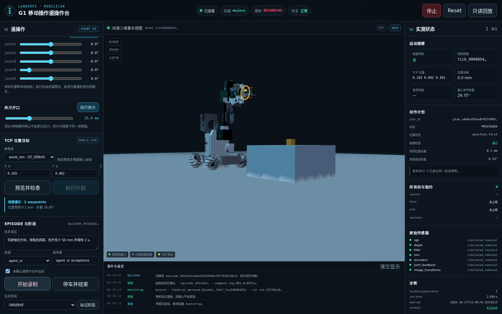
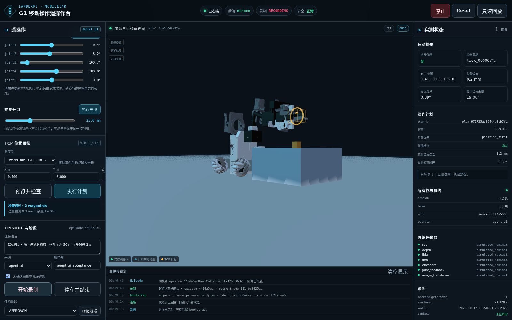
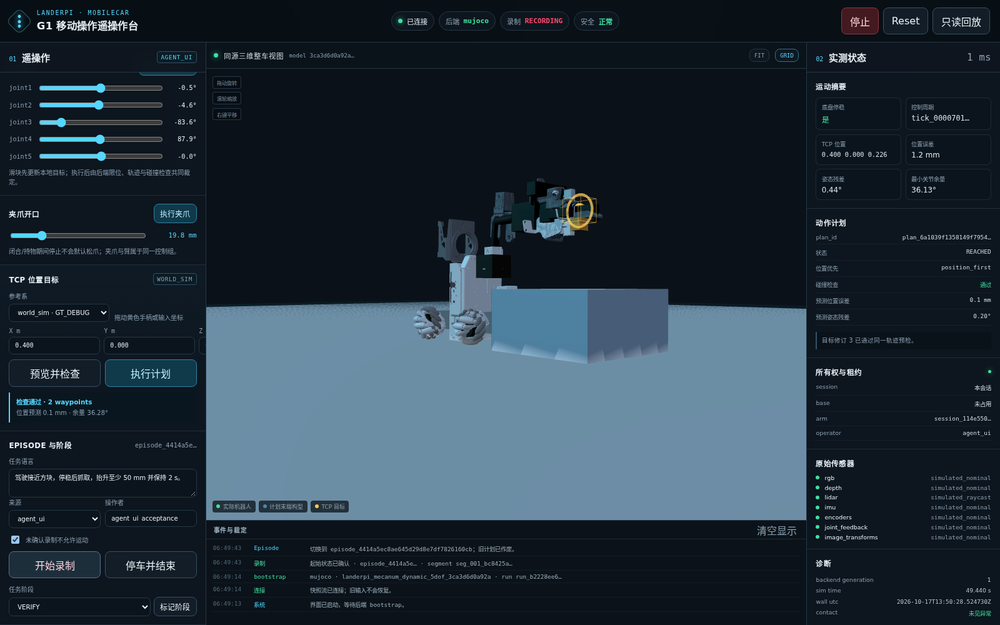
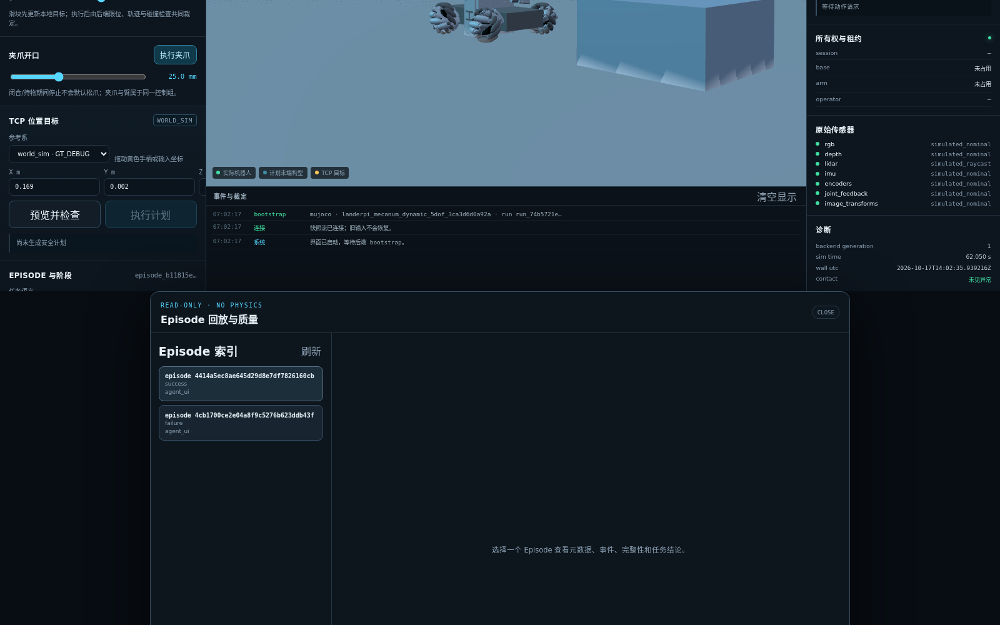
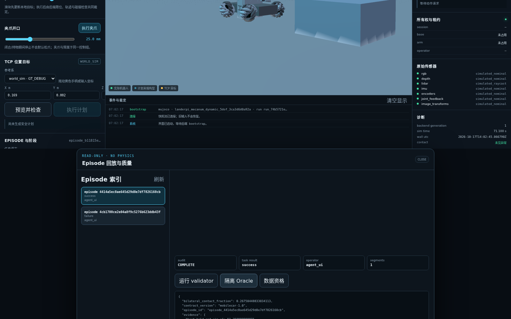

# G1 实际演示记录

日期：2026-10-17。来源：`agent_ui`；视图：第三人称 `third_person_3d`。

## 演示序列

1. 在真实 MuJoCo 后端勾选“未确认录制不允许运动”，通过浏览器开始录制。
2. 控制 agent 以 `agent_ui` 会话持续提交低速底盘 twist 接近方块，至 x≈0.14 m 发送显式零速，等待 0.5 s 连续停稳条件；键盘按住/释放和失焦停车由独立 Chromium 测试覆盖。
3. TCP 预览并执行 `(0.4, 0, 0.2)`，位于方块上方。
4. 预览并执行 `(0.4, 0, 0.127)`，有限力下降。
5. 夹爪执行 0.018 m 闭合目标，等待双侧接触稳定。
6. 预览并执行向上 0.1 m 的固定世界目标；保持超过 2 s。
7. 标记 `VERIFY`，停车并结束录制。
8. Recorder 排空；validator 判定 COMPLETE；隔离 Oracle 判定 success。
9. 在同一浏览器打开只读回放，读取事件时间线、validator、Oracle 和数据资格。

## 视觉证据

## 结果

- 成功率证据 Episode：
  `episode_4414a5ec8ae645d29d8e7df7826160cb`
- 异常证据 Episode：
  `episode_4cb1700ce2e04a8f9c5276b623ddb43f`
- 最大抬升：`0.0959706942 m`
- 双侧接触连续保持：`8.64999999998 s`
- 三个 TCP 目标位置误差：`0.231 mm`、`0.055 mm`、`0.631 mm`
- 结果由隔离 world-sim Oracle 产生，不是 UI 标签或自动 Pick test。
