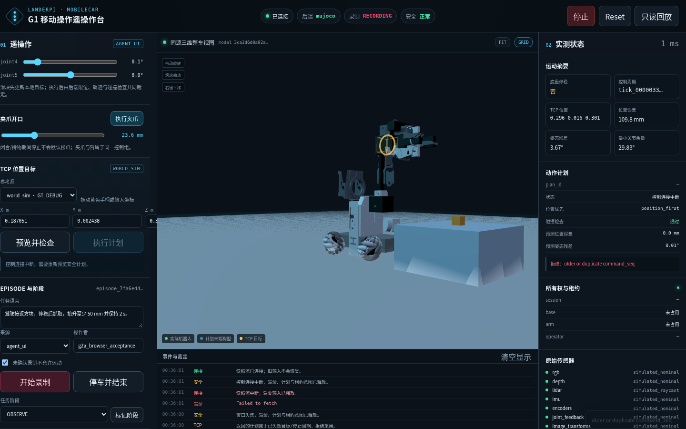

# G2A 实际服务器演示记录

日期：2026-10-17。最终 release：
`g2a-20261017T163244Z-5cbe582fa6b2`。来源：`agent_ui`。

## 1. 顺序

1. 在服务器 release 内用 Node 20 安装锁文件依赖并构建 Three.js bundle。
2. 以 MuJoCo EGL 启动真实后端；唯一物理线程使用 1 ms 步长和 10 ms 控制周期。
3. 开始静止 60 s Episode，不注入模拟帧；5-55 s 分析窗口产生 251 个唯一持久 RGB-D。
4. 结束并完成停车、传感器 quiesce、Recorder 排空、validator、隔离 Oracle 和 G2A 报告。
5. 在同一物理后端开始新 Episode；低速底盘运动、夹爪目标和五轴姿态变化后停稳并结束。
6. 关闭该实例，启动新的 full Chromium 页面实例。
7. 页面真实键盘驾驶、预览负载下驾驶、TCP 预览/执行、失焦停车、断网重连。
8. 完成 30 s 页面 Episode，等待 stop/finalization HTTP 完成后读取 validator。
9. 启动故障注入实例；真实运动后触发 Recorder 写入故障，确认锁存停车和 INCOMPLETE。
10. 启动正常实例，重新录制、移动、停车并确认 COMPLETE。

## 2. 页面证据



WebGL renderer：

```text
ANGLE (NVIDIA, Vulkan 1.4.303, NVIDIA GeForce RTX 4090, NVIDIA)
```

## 3. 页面输入结果

- 延迟预览期间 keydown 到新底盘 twist 到达：0.119 s。
- 窗口失焦到 `zero_base` 到达：0.0084 s。
- 失焦后 keys=0；断连后 keys=0。
- 恢复连接后没有自动重发旧驾驶动作。
- 30.5 s 内 186 个页面命令请求；可达请求均返回 HTTP 200。

## 4. 视觉/文件引用

- renderer probe：[g2a_renderer_probe.json](evidence/g2a_renderer_probe.json)
- 验收汇总：[g2a_server_acceptance.json](evidence/g2a_server_acceptance.json)
- 静止质量：[g2a_stationary_quality.json](evidence/g2a_stationary_quality.json)
- 运动质量：[g2a_motion_quality.json](evidence/g2a_motion_quality.json)
- 远端原始 Episode 和 hash：[g2a_server_artifact_index.json](evidence/g2a_server_artifact_index.json)

本演示证明 G2A 的采集、三维输入和故障链，不将其描述为完整自主抓取或实车演示。
